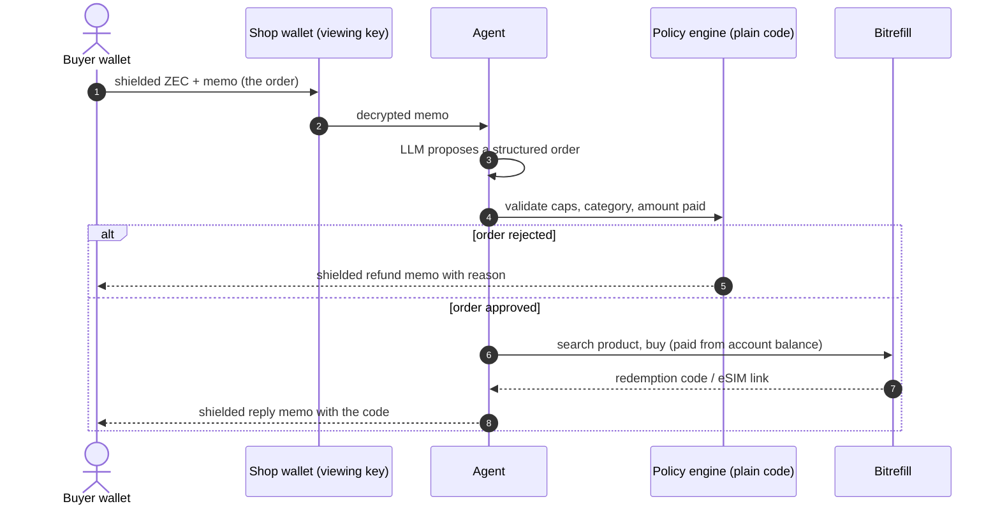
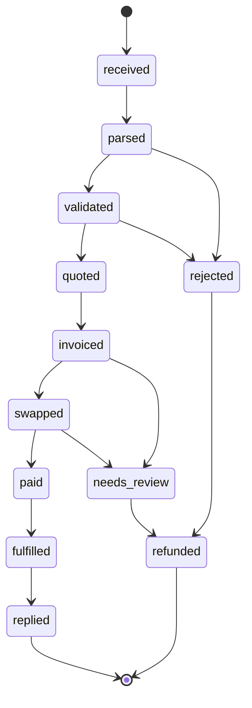

<div align="center">


# Whisper Shop

**The memo is the order.**

Buy real products with shielded Zcash by sending a normal payment with a text note.
No website. No account. No email.

   

</div>

Built for the Zcash FREE SOCIETY Hackathon (Mumbai, 4–5 Nov 2026), targeting the **Zcash Privacy** and **Agentic Commerce (Bitrefill)** tracks.

> **Status:** complete and working on Zcash testnet. A real shielded order was decrypted, a real eSIM was bought from Bitrefill, and the code came back as a shielded memo. See [Testnet proof](#testnet-proof) and [Real vs simulated](#real-vs-simulated).

## Overview

Whisper Shop is an agent that watches a shielded Zcash wallet. A buyer sends ZEC with a memo such as `esim thailand 5gb`. The agent reads the memo, buys the product from [Bitrefill](https://www.bitrefill.com), and replies with the redemption code in a shielded memo. Any Zcash wallet that can attach a memo can shop.

## How it works



### Order states



### Memo format

```
WS1
buy: esim thailand 5gb 7d
max: 12 USD
reply: <unified address>
```

Free text is also accepted and normalised by the LLM. Ambiguous orders get a clarifying memo or a refund.

## Key design decisions

- **Memo as the interface.** Existing Zcash agent projects wrap x402 or MCP. Whisper Shop uses wallet memos for both order and delivery.
- **The LLM never holds spending authority.** It only proposes. Deterministic code enforces caps, allowed categories and the amount paid.
- **Idempotent money steps.** Keyed on txid and output index. Payment steps are never retried automatically.
- **Reusable output.** An open memo-order spec and a TypeScript memo reader and writer.

## Privacy and trust

| Party | Can see |
|---|---|
| Public chain observers | Nothing about order, amount or memo (shielded) |
| Shop operator | Every order and its contents |
| Bitrefill | The invoice and payment |
| Light-wallet server | The shop wallet's IP address and sync pattern, not the memo contents |

Limits, stated plainly:

- Bitrefill does not document ZEC as a payment method, so it is paid from the shop's account balance and ZEC does not pay Bitrefill directly. A ZEC swap would leave the shielded pool.
- Privacy is against outsiders, not against the operator.
- Memos hold about 512 bytes: enough for codes and activation strings, not QR images.

## Real vs simulated

| Component | Needs | Without it |
|---|---|---|
| Zcash wallet (memo read/send) | `zcash-devtool`, funded testnet wallet | Simulated wallet |
| Bitrefill search, purchase, delivery | `BITREFILL_API_KEY` plus the live wallet | Simulated shop |
| Bitrefill payment | Paid from account balance (auto-debit). No swap leg, so ZEC does not pay Bitrefill | Simulated |
| Order parsing | Built-in `WS1` parser | LLM optional |

The console at `/app` shows which adapters are live.

## Testnet proof

Everything below happened on Zcash testnet (NU7). Shielded transactions reveal almost nothing on an explorer, by design: expect `Tx Type: Shielded` and no visible amounts or memo. Full IDs are in [`src/data/proof.json`](./src/data/proof.json).

### Result

**Run 2 was fully unassisted.** The worker decrypted the memo, applied the policy, bought a real eSIM and sent the code back as a shielded memo in about 22 seconds, with no manual steps.

| | Order (buyer to shop) | Reply (shop to buyer) | Outcome |
|---|---|---|---|
| **Run 2** | [`c158b16a…d6bce4`](https://testnet.zcashexplorer.app/transactions/c158b16a37f7e6062f64bef96fbc4526347decc170ed6e615bc12f84f8d6bce4) | [`bda404c9…3f5386`](https://testnet.zcashexplorer.app/transactions/bda404c9cfdead3c1635d0db560b9ed4b6c7688188ef702bb853d730623f5386) | Fully automatic. eSIM bought, link returned in a shielded memo |
| **Run 1** | [`3d9fc024…1d74d3`](https://testnet.zcashexplorer.app/transactions/3d9fc0248a35bf2fc88da224139a333256a886f37bd1f75ae31362fa2a1d74d3) | [`96f99a16…99fede`](https://testnet.zcashexplorer.app/transactions/96f99a16cebf803ce3ad98cd012aa6888b9f3245adecbfadf372ca4dcd99fede) | Order and purchase worked. The worker timed out waiting for delivery, so the reply was sent by `scripts/recover-order.mts` |

Each order memo asked for `esim thailand 1gb 7d` with a 4 USD cap. The agent bought "Bitrefill eSIM Thailand 1GB, 7 Days" for 2.89 USD and the buyer wallet decrypted both reply memos.

### Everything we tried, in order

| # | What | Transaction or invoice | Result |
|---|---|---|---|
| 1 | Testnet faucet funds to the buyer wallet (0.5 TAZ) | [`66941044…b7765e`](https://testnet.zcashexplorer.app/transactions/669410442397b4e881cb0f1db2dbf857b5d43541d8de2ff1ba562edcb6b7765e) | Received |
| 2 | Real Bitrefill purchase from a test script, to verify the parsers | invoice `ec388763-4146-4419-963f-bd86146284d3` | Delivered ($2.89) |
| 3 | The same script re-run by mistake | invoice `5890daf2-4321-4318-a551-c96121dd4028` | Delivered ($2.89), not refunded |
| 4 | Buyer funds the shop wallet for reply fees (0.1 TAZ) | [`f29ddbc3…07bdd3`](https://testnet.zcashexplorer.app/transactions/f29ddbc368bd8d06d793977867ba1424ed620a5420ad2c7d79e16954c207bdd3) | Received |
| 5 | Run 1 order | [`3d9fc024…1d74d3`](https://testnet.zcashexplorer.app/transactions/3d9fc0248a35bf2fc88da224139a333256a886f37bd1f75ae31362fa2a1d74d3) | Shop wallet received it, but the memo was unreadable until the wallet ran `enhance` and the parser handled `Memo::Text` and multi-line memos (both fixed) |
| 6 | Run 1 purchase | invoice `2c244888-c027-484e-9d5c-43b3eef05c49` | Paid and delivered, but the worker gave up after about 2 seconds (polling fixed for real shops) |
| 7 | Run 1 reply, sent by the recovery script | [`96f99a16…99fede`](https://testnet.zcashexplorer.app/transactions/96f99a16cebf803ce3ad98cd012aa6888b9f3245adecbfadf372ca4dcd99fede) | Buyer decrypted it |
| 8 | Run 2 order | [`c158b16a…d6bce4`](https://testnet.zcashexplorer.app/transactions/c158b16a37f7e6062f64bef96fbc4526347decc170ed6e615bc12f84f8d6bce4) | Processed by the worker |
| 9 | Run 2 purchase | invoice `800818ca-def0-4f9d-a07f-fd299abd9349` | Paid and delivered automatically |
| 10 | Run 2 reply | [`bda404c9…3f5386`](https://testnet.zcashexplorer.app/transactions/bda404c9cfdead3c1635d0db560b9ed4b6c7688188ef702bb853d730623f5386) | Buyer decrypted it |

Four real eSIMs were bought in total, all from the account balance (about 11.56 USD). Two came from test-script runs, one of them by mistake. Bitrefill was paid from the account balance, not ZEC (see [Real vs simulated](#real-vs-simulated)). The recovery script only reads an existing invoice and never buys again.

## Quick start

Requires Node.js 20+ and, for live mode, Rust (`cargo`).

```bash
npm install
cp .env.example .env.local
npm run dev                        # http://localhost:3000
```

Simulated mode works immediately. For live testnet mode follow [src/md/SETUP.md](./src/md/SETUP.md).

### Configuration

| Variable | Purpose |
|---|---|
| `BITREFILL_API_KEY` | Bitrefill product search and purchase (paid from account balance) |
| `WHISPER_WALLET_DIR` | Shop wallet directory (keep outside the repo) |
| `WHISPER_IDENTITY` | Shop wallet identity file (keep outside the repo) |
| `ZCASH_SERVER` | lightwalletd alias or URL, default `zecrocks` |
| `MAX_ORDER_USD`, `DAILY_CAP_USD` | Spending caps, defaults 20 and 50 |

All variables, with defaults, are in `.env.example`. Deployment notes (what runs on Vercel and what needs a worker) are in [DEPLOY.md](./src/md/DEPLOY.md).

### Commands

```bash
npm run dev                                                # UI and API
npx tsx --env-file=.env.local scripts/worker.mts 20        # poll shop wallet every 20s
npx tsx scripts/send-order.mts "esim thailand 5gb 7d" 12   # place a testnet order
npx tsx --test src/server/*.test.ts                        # unit tests
```

## Project structure

```
src/app/        Next.js routes: landing, /app console, /orders/[id], /api
src/server/     parser, policy engine, orchestrator, Bitrefill + wallet adapters
scripts/        worker, order sender, connectivity checks
src/md/         all project documentation
```

## Documentation

All docs live in [`src/md/`](./src/md):

| File | Contents |
|---|---|
| [SETUP.md](./src/md/SETUP.md) | Local setup, wallets, running the worker |
| [REQUIREMENTS.md](./src/md/REQUIREMENTS.md) | Accounts, keys, funds and decisions needed |
| [DESIGN.md](./src/md/DESIGN.md) | Architecture, schema, milestones, risks |
| [DEMO_PLAN.md](./src/md/DEMO_PLAN.md) | Demo script and recording checklist |
| [HACKATHON.md](./src/md/HACKATHON.md) | Rules, deadlines, faucets and submission checklist |
| [DEPLOY.md](./src/md/DEPLOY.md) | What runs on Vercel and what needs a worker |
| [SUBMISSION.md](./src/md/SUBMISSION.md) | Ready-to-paste Stadium form answers |

## Roadmap

- [x] Memo parser, policy engine, state machine
- [x] Console, receipt page, orders API
- [x] zcash-devtool wallet adapter
- [x] Verified Bitrefill search, purchase and delivery from account balance
- [x] Shielded reply memo with the eSIM link
- [ ] Pay Bitrefill directly in ZEC (needs a swap; Bitrefill does not document ZEC)
- [ ] Whisper Standing Orders (recurring orders)
- [ ] Publish the memo-order spec and library
- [ ] Pay Bitrefill directly in ZEC through a swap

## License

MIT
